<div align="center">



<a href="https://git.io/typing-svg"></a>


</div>

---

### 👤 `cat about.txt`

```yaml
name:      Muslihiddin
alias:     TheUzbekDev
country:   Uzbekistan 🇺🇿
role:      Telegram bot & Minecraft Bedrock addon developer
also:      Python data pipelines, websites
hosting:   Render + UptimeRobot, Cloudflare
mode:      dev // hacker
motto:     "Kod yoz. Sina. Takrorla."
```

- 🤖 Python bilan **Telegram botlar** yarataman (aiogram, python-telegram-bot, Pyrogram)
- ⛏️ **Minecraft Bedrock** addon va scriptlar yozaman (`@minecraft/server`)
- 📦 Oʻzim uchun kutubxonalar chiqaraman (PyPI)
- 🌐 Saytlarni Cloudflare Pages’da joylayman
- 🎯 Maqsad: har kuni kod yozish, har hafta yangi narsa qurish

---

### 🛠️ `stack --list`

<div align="center">


</div>

---

### 📦 `ls projects/`

| Loyiha | Tavsif | Texnologiya |
|:--|:--|:--|
| 🌟 **MixStar** | Telegram bot: Stars, Premium, TON xizmatlari va Mini App | Python · Flask |
| 💬 **ParadoksGram** | Oʻzim yozayotgan Telegram klient | Android · Windows |
| 🧰 **ms-file-toolkit** | AI function calling uchun fayl vositalari | PyPI · Python |
| ⛏️ **Maqom Tizimi** | Minecraft oʻyinchi rank addoni | JS · Bedrock |
| 🐾 **CyberLine Companion** | Faqat OP oʻyinchilarga boʻysunadigan yordamchi mob | JS · Bedrock |
| 🪐 **EGS Addon** | Minecraft Bedrock addon (AirDrop bilan) | JS · Bedrock |

<div align="center">

<a href="https://github.com/muslihiddinlive/ParadoksGram"></a>
<a href="https://github.com/muslihiddinlive/ParadoksGram-windows"></a>

</div>

---

### 🛤️ `history --timeline`

```text
2026-02  ──►  birinchi saytlar
2026-05  ──►  birinchi Telegram bot (quiz bot)
2026-06  ──►  birinchi Android ilova
2026-11  ──►  ParadoksGram, MixStar, PyPI kutubxonalar
```

---

### 🐍 `snake --eat contributions`

<div align="center">


</div>

---

### 📊 `stats --live`

<div align="center">


</div>

---

### 🎧 `now --playing`

<div align="center">

<a href="https://open.spotify.com/search/Ti%C3%ABsto%20Seavolution"></a>


</div>

---

### 🔤 `note --alphabet`

Bu README **yangi oʻzbek alifbosida** yozilgan: O' → **Oʻ**, G' → **Gʻ**, Sh → **Sh**, Ch → **Ch**. Tutuq belgisi (ʼ) saqlanadi.

---

### 📡 `contact --open`

<div align="center">

[](https://t.me/muslihiddinuz)
[](https://github.com/muslihiddinlive)
[](https://paradoks.pages.dev)
[](https://pypi.org/project/ms-file-toolkit/)


`⭐ Loyihalarim yoqsa — star bosishni unutmang!`

</div>
